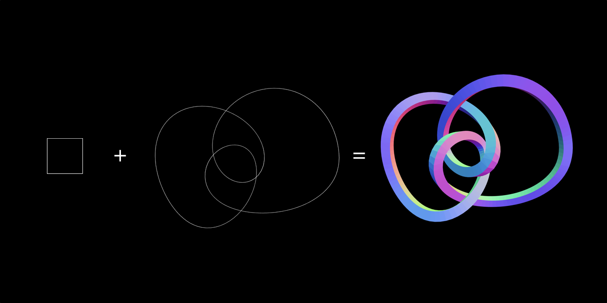

# geom-sweep

Extrudes a shape along a path.



## Installation

```bash
npm install geom-sweep
```

## Usage

```js
import sweep from "geom-sweep";
import { circlePath, squarePath } from "primitive-geometry";

const geometry = sweep(
  circlePath({ segments: 50, closed: true }),
  squarePath({ closed: true }),
  {
    radius: [0.5, 0.5],
    frameOptions: { initialNormal: [0, 0, 1] },
    withFrames: true,
  },
);
// => {
//   positions: Float32Array(1224),
//   normals: Float32Array(1224),
//   uvs: Float32Array(816),
//   cells: Uint16Array(1200),
//   tangents?: Float32Array(1224),
//   binormals?: Float32Array(1224),
// }
```

## API

#### `sweep(geometry, shape, options, out?): geometry`

All attributes are flat arrays (`TypedArray | Array`): `[x, y, z, x, y, z, ...]`, or `[x, y, x, y, ...]` for `uvs` and `radii`.

**Parameters**

- geometry: `{ positions: TypedArray | Array, cells?: Array<TypedArray | Array>, tangents?: TypedArray | Array, normals?: TypedArray | Array, binormals?: TypedArray | Array, radii?: TypedArray | Array }` – a geometry object with positions defining the path to sweep along, in the order of the first polyline in nested `cells` if any (other ones are ignored). Frames are computed with [frenet-serret-frames](https://github.com/dmnsgn/frenet-serret-frames) unless `tangents`, `normals` and `binormals` are all given, keeping given `tangents`, without writing to the geometry. `radii` are x/y radii for every path position (ie. taper): `[rx0, ry0, rx1, ry1, ...]`, multiplied by `options.radius`. Other flat per-vertex attributes (eg. `vertexColors`) are copied to the swept geometry.

- shape: `{ positions: TypedArray | Array, cells?: Array<TypedArray | Array> | TypedArray | Array, uvs?: TypedArray | Array }` – a planar shape in the XY plane, analysed with [geom-extrude](https://github.com/dmnsgn/geom-extrude):
  - polylines (`cells` as an array of index arrays): closed ones repeat their first index or position, nested loops are holes.
  - triangles (flat `cells`): walls along the boundary, triangles as caps.
  - positions only: a single polyline.

  Other flat per-vertex attributes (eg. `vertexColors`) are copied to the swept geometry. Path attributes win over shape attributes of the same name.

- options.radius: `[x, y]` (default: `[1, 1]`) - extruded geometry x/y radii.
- options.closed: `boolean | "auto"` (default: `"auto"`) - is the path closed. `"auto"` closes paths ending on their first index or position (compared exactly), dropping that last one.
- options.closedShape: `boolean | "auto"` (default: `"auto"`) - are the shape polylines closed. `"auto"` closes polylines ending on their first index or position.
- options.capStart: `boolean` (default: `true`) - add a cap at the start of open paths, for closed shapes.
- options.capEnd: `boolean` (default: `true`) - add a cap at the end of open paths, for closed shapes.
- options.capMapping: `Function` (default: shape `uvs` or `mappings.circumferential`) - overrides the cap uvs with a [primitive-geometry](https://github.com/dmnsgn/primitive-geometry) mapping.
- options.creaseAngle: `number` (default: `Math.PI / 6`) - shape turns sharper than this angle (in radians) keep hard wall edges.
- options.frameOptions: `Object` (default: `{}`) - [frenet-serret-frames](https://github.com/dmnsgn/frenet-serret-frames) options (`mode`, `initialNormal`, `finalNormal`, `twist`) used when the path has no frames. `closed` follows `options.closed`.
- options.withFrames: `boolean` (default: `false`) - compute tangents and binormals.

- out: `{ positions: TypedArray, normals: TypedArray, uvs: TypedArray, cells: TypedArray, tangents?: TypedArray, binormals?: TypedArray }` (default: `{}`) – a previously swept geometry to write into, reusing its arrays: same path, shape and options.

**Returns**

geometry: `{ positions: TypedArray, normals: TypedArray, uvs: TypedArray, cells: TypedArray, tangents?: TypedArray, binormals?: TypedArray }` - the swept geometry with optional tangents and binormals, and copied attributes. Uvs wrap u once around each shape loop and v along the path length. Closed paths end on a copy of their first ring for the v seam.

## License

MIT. See [license file](https://github.com/vorg/geom-sweep/blob/master/LICENSE.md).
